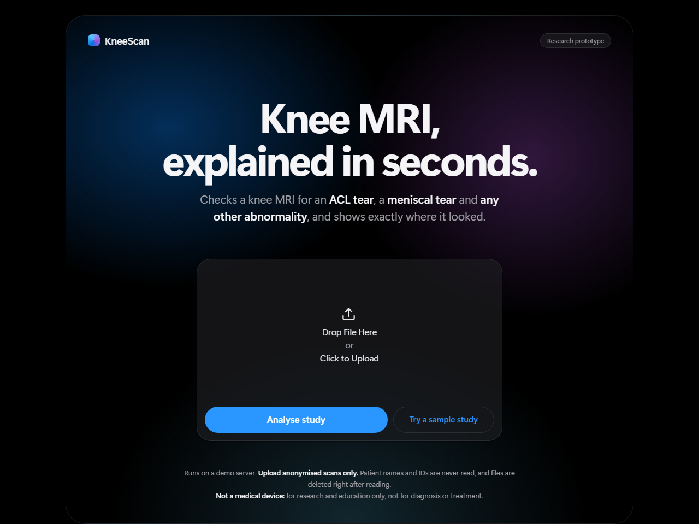
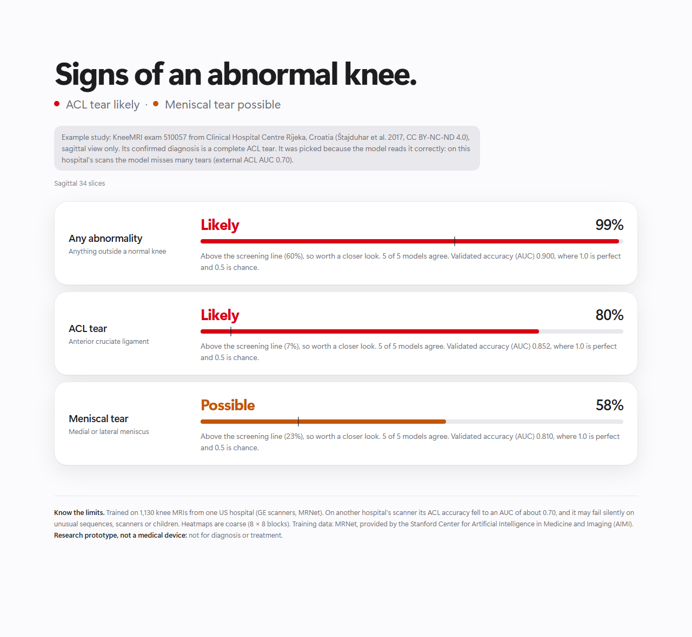
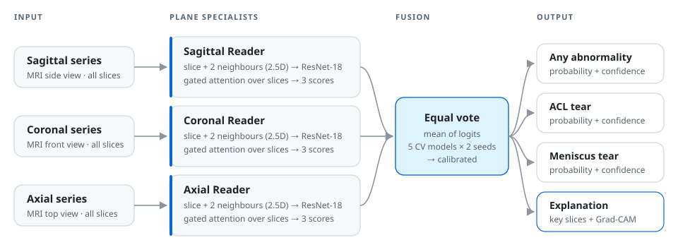
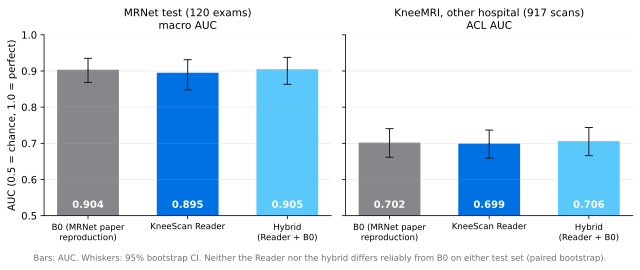

<div align="center">

# KneeScan Assist

**Knee MRI, read and explained.**<br>
A deep-learning research prototype that reads a full knee MRI exam, estimates three findings,
and shows exactly which slices and regions the decision came from.

[](https://github.com/nj-codes-24/kneescan-assist/actions/workflows/tests.yml)


[](LICENSE.txt)


[Approach](#how-it-works) · [Results](#results) · [Run it](#run-it-yourself) · [Limitations](#limitations) · [Docs](#documentation)

</div>

> [!WARNING]
> **Research and education prototype. NOT a medical device.** Not cleared or approved by any regulator. It must not be used
> for diagnosis or treatment decisions. Outputs can be wrong; heatmaps show where the model looked, not proof of a finding.

<p align="center">
  
  
</p>

KneeScan Assist reads a knee MRI exam (sagittal, coronal and axial series) and estimates the probability of three findings:
**any abnormality**, **ACL tear** and **meniscus tear**. For each finding it shows a confidence level and heatmaps on the slices it relied on.

The example in the screenshot is a KneeMRI exam with a confirmed complete ACL tear, picked because the model reads it correctly. On that
hospital's scans the model misses many tears (external ACL AUC 0.70). The repository shows no scans; heatmaps appear only in the running
app (see [why](#why-there-are-no-scans-in-this-readme)).

## At a glance

<div align="center">

| **0.905** | **0.942** | **0.70** | **1×** |
|:---:|:---:|:---:|:---:|
| macro AUC on the one-time final test<br>(hybrid model) | ACL-tear AUC on the final test<br>(explainable Reader) | ACL AUC on an external hospital<br>(honest domain-shift result) | times the final test set was opened<br>(after the models were frozen) |

</div>

**What makes this project different**

- 🔒 **Evaluation rules fixed before training.** The protocol ([docs/EVAL_PROTOCOL.md](docs/EVAL_PROTOCOL.md)) was written first; the final test set was opened **once**, after the models were frozen.
- 🧪 **Every number in this README is tested.** CI compares each figure with the original reports in [evidence/](evidence/README.md), which are stored byte-for-byte with SHA-256 fingerprints.
- 🔍 **Explainable by design.** Attention over slices picks the *key slices*; Grad-CAM shows *where* in each slice the evidence came from.
- 🌍 **External validation.** Tested on a second hospital (Croatia, Siemens scanners), and the drop is reported, not hidden.
- 📋 **Licence-aware engineering.** An automated audit blocks data, labels, weights and secrets from ever reaching GitHub.
- 📝 **Full paper trail.** 28 recorded decisions and every experiment, kept or rejected, with its numbers.

## How it works

<p align="center">
  <picture>
    <source media="(prefers-color-scheme: dark)" srcset="docs/images/architecture_dark.svg">
    
  </picture>
</p>

- **One specialist per plane.** Training one network on all three planes made them interfere: the coronal branch's ACL AUC fell to 0.61.
  Specialists fixed that (decisions D-013, D-014).
- **2.5D input.** Each slice is read together with its two neighbours, giving the 2D backbone some 3D context at 2D cost.
- **Attention over slices** decides which slices matter for each finding. The weights *are* the key-slice explanation.
- **Five cross-validation models** form the ensemble. How many of them agree is the confidence shown to the user.

## Results

### Final test (run once)

MRNet `valid`: 120 exams never used before; EVAL_PROTOCOL §8, models frozen in [docs/FROZEN.md](docs/FROZEN.md).



| Model | Macro AUC (95% CI) | Abnormal | ACL | Meniscus |
|---|---|---|---|---|
| B0: our reproduction of Bien et al. 2018 (MRNet) | **0.904** (0.868–0.935) | 0.934 | 0.934 | 0.843 |
| **KneeScan Reader** (3 plane specialists, 2 seeds) | 0.895 (0.848–0.931) | 0.929 | **0.942** | 0.814 |
| Hybrid: Reader + B0 (mean logit) | **0.905** (0.863–0.938) | 0.934 | 0.941 | 0.840 |

- Paired gains vs B0 on the same 120 exams: Reader −0.008 (95% CI −0.032 to +0.012), Hybrid +0.001 (−0.011 to +0.011). **Both statistically tied
  with the baseline.** The explainable Reader matches the 2018 method while also showing its key slices and heatmaps.
- For reference only (a different 120-exam hidden test set): the MRNet paper reports 0.937 / 0.965 / 0.847. Our B0 reproduction lands close.
- **External test, KneeMRI** (917 volumes, Croatia, Siemens, sagittal only; ACL): AUC 0.702 (B0), 0.699 (Reader), 0.706 (Hybrid).
  A large drop under domain shift, for every model.

### Cross-validation

Pooled out-of-fold, 1,130 `train` exams; used for every model choice.

| Model | CV macro AUC (95% CI) | Abnormal | ACL | Meniscus |
|---|---|---|---|---|
| B0 | 0.855 (0.839–0.869) | 0.896 | 0.859 | 0.809 |
| R1b: one Reader for all planes | 0.833 (0.816–0.849) | 0.889 | 0.822 | 0.787 |
| R2: three plane specialists | 0.850 (0.835–0.865) | 0.896 | 0.846 | 0.809 |
| Reader (R2, 2 seeds) = final Reader | 0.854 (0.839–0.868) | 0.900 | 0.852 | 0.810 |
| Hybrid: Reader + B0 | 0.864 (0.849–0.877) | 0.904 | 0.867 | 0.821 |

In CV the hybrid beat B0 (+0.009, CI +0.006 to +0.013), but that gain **didn't replicate** on the 120-exam test (+0.001). Both results are
reported. Every experiment, kept or not, is in [docs/experiments.md](docs/experiments.md), and every decision with its evidence is in
[docs/decisions.md](docs/decisions.md).

### How to check these numbers

- **The original outputs are in [evidence/](evidence/README.md)**: the final-test report and its lock file, every cross-validation
  report, and the per-epoch training log of every run, copied unchanged with SHA-256 fingerprints.
- **The numbers above are tested against them.** [tests/test_evidence.py](tests/test_evidence.py) compares every number in these
  tables with the reports, and checks that the model was frozen *before* the one-time test and that the test
  ran once. GitHub Actions reruns it, with the full test suite, the smoke test and the audit, at every push (badge at the top).
- **The weights that were tested** are identified by the SHA-256 of every file in [docs/frozen.yaml](docs/frozen.yaml). The weights
  and the per-exam predictions stay private, because the data licences don't allow sharing them.

## Run it yourself

No data or GPU is needed for the tests and the smoke test: they run on synthetic data, exactly as CI does.

**Windows (PowerShell, from the repo root)**

```powershell
python -m venv .venv
.venv\Scripts\python.exe -m pip install -r requirements.txt
.venv\Scripts\python.exe -m pytest                                  # unit tests
.venv\Scripts\python.exe scripts\smoke_test.py                      # whole pipeline on fake data, ~1 minute
.venv\Scripts\python.exe scripts\pipeline.py --stage prepare        # MRNet (your Redivis login) + KneeMRI checks
.venv\Scripts\python.exe scripts\pipeline.py --stage train          # B0 + the plane specialists (GPU, hours; resumable)
.venv\Scripts\python.exe scripts\pipeline.py --stage evaluate       # CV report and paired comparison with B0
.venv\Scripts\python.exe scripts\pipeline.py --stage explain        # failure gallery + heatmap sanity check
.venv\Scripts\python.exe app\clinic_app.py                          # demo app on http://127.0.0.1:7860
```

<details>
<summary><b>Linux / macOS (tests and smoke test, CPU only)</b></summary>

```bash
python3.11 -m venv .venv && source .venv/bin/activate
pip install torch==2.8.0 torchvision==0.23.0 --index-url https://download.pytorch.org/whl/cpu
pip install -r requirements.txt
python -m pytest -q                 # unit tests, including README numbers vs evidence/
python scripts/smoke_test.py        # whole pipeline on synthetic data
python scripts/audit_repo.py        # nothing licensed or secret would be committed
```

These are the same steps the CI workflow runs on Ubuntu ([.github/workflows/tests.yml](.github/workflows/tests.yml)).
</details>

Data is **not** included and must be obtained under its own licence (see [docs/DATA.md](docs/DATA.md)): MRNet via Stanford AIMI / Redivis,
KneeMRI via Zenodo. Trained weights are not included either: they're trained on MRNet, so they stay in a private model repository.

<details>
<summary><b>Deploying the demo (container build, tested but not deployed)</b></summary>

A container build of the app, tested under a 2 vCPU / 4 GiB limit, is ready for a server ([docs/HOSTING.md](docs/HOSTING.md)), but no
public instance is hosted. It is packed by two scripts:
`scripts/export_weights.py` copies the 30 tested weight files (checked against the frozen SHA-256 fingerprints) for a private
Hugging Face model repo, and `scripts/build_deploy.py` builds the container folder (Dockerfile, CPU-only PyTorch, the KneeMRI example)
that runs on Azure Container Apps.
</details>

## Project structure

```
kneescan-assist/
├── kneescan/            # the library
│   ├── data/            #   MRNet + KneeMRI loaders, CV splits, 2.5D transforms, synthetic data
│   ├── models/          #   B0 (MRNet reproduction) and the Reader (ResNet-18 + gated attention)
│   ├── train/           #   trainers, configs, seeding, run logging
│   ├── eval/            #   AUC + bootstrap CIs, calibration, plane fusion, final-test metrics
│   ├── explain/         #   key slices, Grad-CAM, failure-case gallery
│   └── app/             #   DICOM upload + predictor used by the demo
├── app/                 # Gradio clinic app (views + theme)
├── scripts/             # one-command pipeline, training, evaluation, audit, deploy build
├── configs/             # every experiment as a YAML file
├── splits/              # frozen CV folds (case IDs only, never labels)
├── evidence/            # original reports + training logs, SHA-256 fingerprinted
├── docs/                # protocol, decisions, experiments, model card, data licences
└── tests/               # unit tests, README-vs-evidence checks, audit tests
```

## Limitations

- Trained on one dataset: MRNet, 1,130 exams from one US hospital (Stanford, GE scanners). It may fail silently on other scanners,
  sequences or populations. KneeMRI (Croatia, Siemens, sagittal only) is the external check.
- MRNet labels come from clinical reports, not from a second expert read, so some "errors" may be label noise (docs/failure_cases.md).
- MRNet doesn't release patient IDs, so CV folds can't be grouped by patient (about 42 repeat exams). The official test split is patient-disjoint.
- Heatmaps are coarse (8 × 8 blocks per slice) and show evidence used, not anatomy understood. A randomisation check confirms they depend
  on what was learned (docs/failure_cases.md).
- The final test has 120 exams. Its confidence intervals are wide (about ±0.03–0.08 AUC), too wide to confirm gains of ~0.01.
- Large drop on a different scanner and protocol (KneeMRI ACL AUC ≈ 0.70 for all models).

### Why there are no scans in this README

The MRNet Research Use Agreement forbids publishing any part of the dataset, and KneeMRI's CC BY-NC-ND 4.0 licence forbids sharing
adapted images such as heatmap overlays. So the README shows charts and app screenshots only, and heatmaps appear only in the running
app (decision D-025, [docs/images/SOURCES.md](docs/images/SOURCES.md)). The failure-case analysis describes each error in words instead
([docs/failure_cases.md](docs/failure_cases.md)).

## Documentation

| Start here | |
|---|---|
| [docs/decisions.md](docs/decisions.md), [docs/experiments.md](docs/experiments.md) | every decision and experiment, with numbers |
| [evidence/](evidence/README.md) | the original reports and training logs behind the numbers, and how to check them |
| [docs/EVAL_PROTOCOL.md](docs/EVAL_PROTOCOL.md) | evaluation rules, fixed before training |
| [docs/model_card.md](docs/model_card.md) | intended use, data, metrics, limitations |
| [docs/failure_cases.md](docs/failure_cases.md) | where the model goes wrong, and why |
| [docs/DESIGN.md](docs/DESIGN.md) | system design and the clinic app |
| [docs/DATA.md](docs/DATA.md) | datasets, licences, what we may do |
| [docs/HOSTING.md](docs/HOSTING.md) | optional: running the demo on a server (container build, tested; not deployed) |

## Background

This project grew out of my entry to the [RSNA Knee Abnormality Detection](https://www.kaggle.com/competitions/rsna-knee-abnormality-detection)
competition on Kaggle. It is a separate, from-scratch build on public research datasets: it uses **no competition data and no
competition-trained weights** ([docs/DATA.md](docs/DATA.md)).

## Acknowledgements

- MRNet: Bien N, Rajpurkar P, et al. PLOS Medicine 2018. Stanford ML Group / Stanford AIMI. This research used data provided by the
  Stanford Center for Artificial Intelligence in Medicine and Imaging (AIMI).
- KneeMRI: Štajduhar I, et al. Computer Methods and Programs in Biomedicine 2017. Clinical Hospital Centre Rijeka (CC BY-NC-ND 4.0).
- RadImageNet weights were evaluated but not used in the final model (docs/decisions.md D-022): Mei X, et al. Radiology: Artificial Intelligence 2022.

## License

The **code** in this repository is released under the [MIT License](LICENSE.txt). The datasets and trained weights are **not** part of
this repository and remain under their own licences ([docs/DATA.md](docs/DATA.md)).

<div align="center">
<sub>Built by <a href="https://github.com/nj-codes-24">Nishchal Jain</a> · B.Tech Artificial Intelligence & Data Science, IIITDM Kurnool</sub>
</div>
